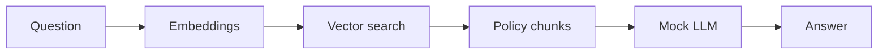

# Learning Guide — Instamart Customer Intelligence & Support Co-Pilot

Beginner-friendly walkthrough of the implemented project. Important ideas include short **Tamil (தமிழ்)** notes.

---

## Chapter 1 – Project Overview

**What are we building?** A single Python system that cleans Instamart-style data, finds customer segments, classifies support tickets safely, and answers policy questions using RAG—all without paid LLM keys.

**தமிழ்:** வாடிக்கையாளர் தரவு சுத்திகரிப்பு, பிரிவுகள், டிக்கெட் வகைப்பாடு, கொள்கை பதில்கள் — இவை ஒரே திட்டத்தில்.

**Workflow:** `run_project.py` → clean data → SQLite → RFM/K-Means → triage → RAG → refund simulation.

---

## Chapter 2 – Environment Setup (Windows)

```powershell
python -m venv .venv
.\.venv\Scripts\Activate.ps1
pip install -r requirements.txt
python run_project.py
jupyter notebook notebooks/Customer_Intelligence_Support_Copilot.ipynb
```

**தமிழ்:** `venv` என்பது தனி Python சூழல் — நூலகங்கள் மற்ற פרோஜெக்டுகளுடன் கலவாது.

---

## Chapter 3 – Datasets (actual columns)

| Dataset | Key columns |
|---------|-------------|
| `customers.csv` | customer_id, name, email, phone, gender, city, registration_date |
| `orders.csv` | order_id, customer_id, order_date, order_status, order_amount, city |
| `support_tickets.csv` | ticket_id, ticket_text, category_label, priority, status |
| `policy_evaluation.csv` | policy_id, policy_title, policy_text, sample_question |

Synthetic data from `generate_data.py` (not official Swiggy data).

---

## Chapter 4 – Data Cleaning

**What is it?** Fixing duplicates, typos (`bangalore` → `Bengaluru`), invalid amounts.

**Where?** `src/data_foundation/clean.py` → saves `data/processed/*_clean.csv`.

**தமிழ்:** தரவு சுத்திகரிப்பு = தவறான/காணாமல் போன மதிப்புகளை சரிசெய்தல்.

---

## Chapter 5 – EDA

Charts in `outputs/eda/` (city distribution, order status, ticket categories).

**Business insight:** See which cities and complaint types dominate.

---

## Chapter 6 – SQLite

**Why?** Fast lookups for orders in refund agent.

**File:** `database/Instamart_DB.sqlite` — tables `customers`, `orders`, `tickets`.

**தமிழ்:** SQLite = ஒரு கோப்பில் வைக்கப்பட்ட சிறிய தரவுத்தளம்.

---

## Chapter 7 – Customer Segmentation

### RFM

- **Recency:** Days since last completed order (reference date in `.env`)
- **Frequency:** Count of completed orders
- **Monetary:** Total spend on completed orders

### K-Means

**What is it?** Groups customers with similar RFM numbers.

**தமிழ்:** K-Means = ஒப்பான வாடிக்கையாளர்களை குழுக்களாக பிரித்தல்.

**Outputs:** `outputs/segmentation/kmeans_evaluation.csv`, `customer_segments.csv`, elbow/silhouette charts.

### PCA

2D plot for visualization only — clustering still uses scaled RFM features.

---

## Chapter 8 – Churn and Retention

**Important:** This project has **no real churn label**. We do **not** report fake Accuracy/F1.

**Retention:** `retention_list.csv` flags at-risk / low-engagement behaviour.

**தமிழ்:** Churn = வாடிக்கையாளர் விட்டுச்செல்வது; நாம் இங்கு நடத்தை அடிப்படையில் அபாய குறியீடு மட்டும்.

---

## Chapter 9 – NLP Ticket Classification

Categories: Refund, Delivery Delay, Payment, Fraud, Product Quality, App Issue, Other.

**Where?** `src/ticket_triage/classifier.py` + `triage.py` CLI.

---

## Chapter 10 – LLM Guardrails

1. Reject empty / whitespace / oversized input  
2. Mask email, phone, order IDs  
3. Mock LLM never sees raw PII  

**Zero-shot vs few-shot:** Instructions only vs instructions + anonymised examples (`prompts.py`).

**தமிழ்:** Guardrails = பாதுகாப்பு விதிகள்; PII = தனிப்பட்ட தகவல்.

---

## Chapter 11 – RAG



**தமிழ்:** RAG = தொடர்புடைய கொள்கை வாக்கியங்களை தேடி, அதன் அடிப்படையில் பதில் உருவாக்குதல்.

Code: `src/rag/assistant.py`.

---

## Chapter 12 – Refund Agent

Steps: validate → order lookup (SQLite) → policy (RAG) → simulated decision → log to `simulated_refunds.jsonl`.

**Never real money.**

---

## Chapter 13 – FastAPI & Streamlit

- API: `uvicorn api.main:app --reload`
- UI: `streamlit run frontend/app.py`

---

## Chapter 14 – Testing

`pytest -q` — see `docs/TESTING_GUIDE.md`.

---

## Chapter 15 – End-to-End Commands

1. `pip install -r requirements.txt`  
2. `python run_project.py`  
3. `pytest -q`  
4. Start API + Streamlit  

---

## Chapter 16 – Outputs

| Output | Path |
|--------|------|
| Clean data | `data/processed/` |
| EDA | `outputs/eda/` |
| Segments | `outputs/segmentation/` |
| Triage | `outputs/ticket_triage/` |
| RAG samples | `outputs/rag/` |
| Models | `models/*.joblib` |

---

## Chapter 17–18 – Limitations & Summary

Mock LLM, synthetic data, sklearn TF-IDF embeddings by default. You learned the pipeline from **pandas cleaning** through **clustering**, **NLP guardrails**, and **RAG agents** in one business story.
