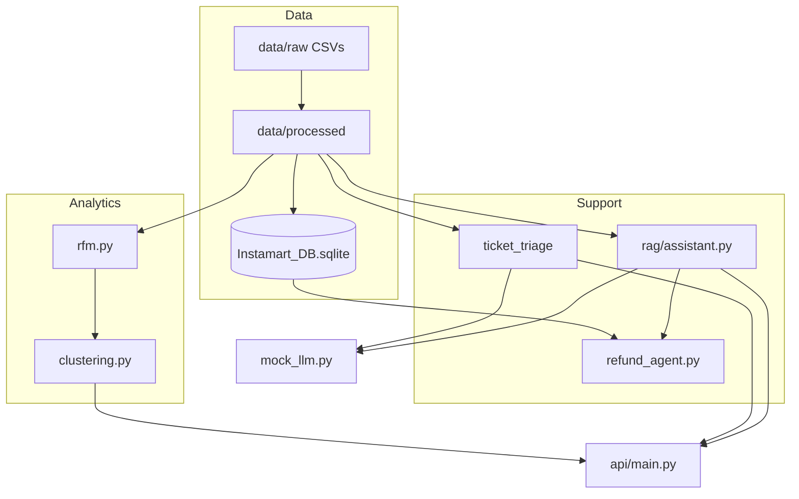
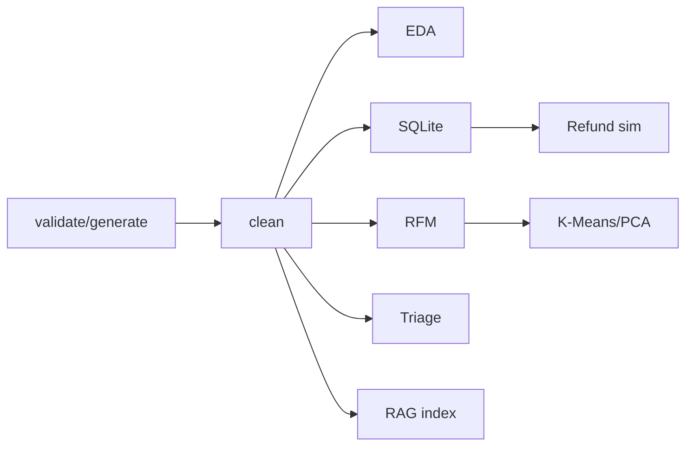

# Technical Documentation

## Solution architecture

## Key modules

| Module | Functions |
|--------|-----------|
| `src/data_foundation/load.py` | `load_raw_datasets`, `validate_raw_files` |
| `src/data_foundation/clean.py` | `clean_all_datasets` |
| `src/database/sqlite_db.py` | `create_database`, `validate_database` |
| `src/customer_analytics/rfm.py` | `calculate_rfm` |
| `src/customer_analytics/clustering.py` | `run_kmeans_pipeline` |
| `src/ticket_triage/guardrails.py` | `apply_guardrails`, `mask_pii` |
| `src/ticket_triage/classifier.py` | `classify_ticket` |
| `src/rag/assistant.py` | `RAGAssistant.build`, `ask` |
| `src/agents/refund_agent.py` | `RefundAgent.process` |

## Data flow pipeline

## Churn decision

No `churned` column in synthetic `customers.csv` — see `outputs/segmentation/churn_modelling_report.md`.

## PII masking

Regex-based masking in `guardrails.py` before any LLM prompt.

## RAG

- Chunking: LangChain `RecursiveCharacterTextSplitter` or fixed windows
- Embeddings: TF-IDF (`EMBEDDING_BACKEND=sklearn`) persisted in `models/tfidf_vectorizer.joblib`
- Vector store: in-memory cosine similarity + `data/knowledge_base/vector_index.json`

## Security

- Parameterised SQL in `order_lookup.py`
- No real payment APIs
- Fraud paths escalate to human
